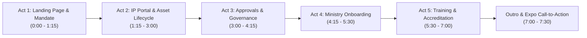

# Kiddies Media Ministry (KMM) Platform Demonstration Script & Screen Recording Guide

> **Production Guide & Voiceover Script**  
> **Target Duration:** 6 – 8 Minutes (or modular 1–2 minute chapters)  
> **Target Audience:** Ministry Executives, Agency Directors, Department Heads, Expo Attendees & Content Creators  
> **Live Production URL:** `https://kiddiesmediaministry.org`

---

## 🎬 Pre-Recording Setup Checklist

Before pressing record, prepare your browser window for an executive-grade recording:

1. **Resolution & Scaling:** Set your browser window to **1920 × 1080 (1080p)**, zoom at **100%**.
2. **Clean Environment:** Close extraneous tabs, hide browser bookmarks bar (`Ctrl+Shift+B` or `Cmd+Shift+B`), and silence OS notifications.
3. **Pre-Loaded Tabs (Recommended):**
   - **Tab 1:** `https://kiddiesmediaministry.org/` *(Landing Page)*
   - **Tab 2:** `https://kiddiesmediaministry.org/signin` *(IP Portal Sign In)*
   - **Tab 3:** `https://kiddiesmediaministry.org/onboarding` *(Ministry Onboarding)*
   - **Tab 4:** `https://kiddiesmediaministry.org/auth` *(Training Portal Auth & Signup)*
4. **Theme Setting:** Ensure your initial view is in **Light Mode** to showcase the signature KMM sky blue, white, and gold palette.

---

## ⏱️ Video Structure & Chapter Breakdown

---

## 📽️ Act 1: The Public Landing Page & Governance Mandate
**Timestamp:** `0:00 – 1:15` | **Screen URL:** `/`

### Visual Cue (What to Show)
- Start with a full-screen view of the **Hero Section**.
- Hover smoothly over the **Kiddies Media Ministry** gold-ringed logo and title.
- Point cursor to the main tagline: *"Policy, Training & Governance for Kingdom Kids Media"*.
- Scroll down gently past the **Core Mandates** (Child Safeguarding, IP Clearance, Broadcast Standards).
- Open the **Agencies & Ministries Dropdown** in the top navigation, highlighting key agencies and onboarded departments:
  1. *Lovetoons Animation*
  2. *Publishing Agency*
  3. *Digital Agency*
  4. *Academy Agency*
  5. *Educational Agency*
- Scroll down to the **Agencies Showcase** section to display the agency cards.
- Scroll to the **Ministry Onboarding Waitlist** banner at the bottom of the landing page.
- Scroll back to the top and click **"Enter IP Portal"** in the navigation header.

### Voiceover Script (What to Say)
> *"Welcome to the Kiddies Media Ministry digital platform. As our Ministry expands its worldwide production of Christian animation, literature, music, and educational resources, the need for robust intellectual property governance and statutory child safeguarding has never been greater.*
>
> *This public landing page establishes KMM's sovereign mandate across Loveworld Nation. It brings together our five core agencies—Lovetoons, Publishing, Digital, Academy, and Educational—under a unified regulatory umbrella.*
>
> *From here, church entities, animators, and content creators can explore our operational framework, access accredited training, and enter our enterprise Intellectual Property Portal. Let’s sign in to explore the internal governance registry."*

---

## 📽️ Act 2: IP Portal Authentication, Dashboard & Asset Lifecycle
**Timestamp:** `1:15 – 3:00` | **Screen URL:** `/signin` ➔ `/dashboard` ➔ `/assets`

### Visual Cue (What to Show)
- **At `/signin`:**
  - Show the newly updated **Light Theme** authentication card. Point out the top bar with **"← KMM Website"** and the **Theme Switcher** (`☀️ Light / 🌙 Dark`).
  - Click the Theme Toggle once to demonstrate dark mode, then click it back to light mode to demonstrate zero-friction contrast.
  - In the **Quick Demo Access** section, click **"Super Admin (admin@lovetoons.tv)"** to auto-fill the form, then click **"Sign In to Portal"**.
- **At `/dashboard`:**
  - Show the **Welcome Splash** with the animated welcome greeting.
  - Mouse over the 4 primary KPI cards:
    - *Registered Ministry Assets (125+)*
    - *Pending Approvals*
    - *High Risk Alerts*
    - *Overall Clearance Ratio (94.2%)*
  - Hover over the **Distribution & Agency Breakdown Chart**.
- **At `/assets`:**
  - Click **"Assets"** in the left sidebar navigation.
  - Show the searchable asset registry (Lovetoons episodes, books, music tracks, school packs).
  - Click the **"+ New Asset"** button in the top right to open the modal.
  - In the modal:
    - Title: Type *"The Golden Shield - Episode 4"*.
    - Category: Select *"Animation Episode"*.
    - Show that the **Agency / Entity** is automatically bound (Zero-Selection)—no dropdown hassle.
    - Show the **Dynamic Risk Level Assessment** indicator responding in real-time.
    - File Upload: Click **"Browse"** under *Attached Document / Deed Name*. Select a sample PDF (`Minor_Talent_Release_Form.pdf`).
    - Explain that the file is safely stored directly with strict size and format protections.
    - Click **"Register Asset in Archive"**.

### Voiceover Script (What to Say)
> *"Here on the IP Portal authentication screen, officers experience a clean, modern interface with instant light and dark theme switching. Using our secure single sign-on, we’ll log in as Super Admin.*
>
> *Upon entry, the Executive Dashboard provides instant visibility into every intellectual property asset stewarded across Loveworld Nation. We see real-time clearance metrics, pending rights approvals, and distribution across video, publishing, and digital apps.*
>
> *Moving to the Asset Registry, every production—from a Lovetoons animated series to a Sunday school curriculum package—is cataloged with full chain-of-title records.*
>
> *When registering a new asset, our system introduces zero-selection automatic entity binding. The platform detects the user's agency, calculates real-time risk scores based on minor voice actors and soundtrack clearances, and uploads legal covenants securely with strict limits and sanitized format verification."*

---

## 📽️ Act 3: Clearance Gates, Risk Assessment & Super Admin Approvals
**Timestamp:** `3:00 – 4:15` | **Screen URL:** `/rights` ➔ `/approvals`

### Visual Cue (What to Show)
- **At `/rights` (or Governance Tab):**
  - Click on **"Rights & Governance"** in the sidebar.
  - Open an asset record (e.g. *Lovetoons Episode 101*).
  - Highlight the **6 Statutory Clearance Gates**:
    1. *Voice Actor & Minor Talent Release*
    2. *Original Soundtrack & Music Copyright Clearance*
    3. *Character Design & Visual Asset Originality*
    4. *Statutory Child Safeguarding & Strobing Compliance*
    5. *Parental / Guardian Consent Verification*
    6. *Jurisdictional & Global Broadcast Rights Clearance*
  - Click **"Add Proof / Notes"** to demonstrate attaching a legal deed verification.
- **At `/approvals`:**
  - Navigate to **"Approvals"** in the sidebar.
  - Show the queue of pending assets submitted by agency officers and ministry departments.
  - Select an asset under review.
  - Show the **Executive Review Panel**:
    - Review chain-of-title documents.
    - Verify compliance flags.
  - Click **"Approve Asset Clearance"**.
  - Show the success toast and the status changing to **"Approved & Broadcast Cleared"** with cryptographic verification timestamp.

### Voiceover Script (What to Say)
> *"Every asset in Kiddies Media Ministry must pass through six statutory compliance gates before it is cleared for global broadcast. These verify that minor talent contracts are executed, original music rights are cleared, and visual strobing frequencies comply with child protection safety standards.*
>
> *In the Approvals module, the Esteemed Executive Minister and Super Admin team review submitted assets. With complete transparency into legal attachments, reviewer notes, and risk ratings, the administrator can grant official broadcast seals or request remediation in seconds.*
>
> *Once approved, the asset is stamped with an immutable digital clearance seal, ready for satellite transmission and international digital distribution."*

---

## 📽️ Act 4: Onboarding a New Ministry / Department
**Timestamp:** `4:15 – 5:30` | **Screen URL:** `/onboarding`

### Visual Cue (What to Show)
- Navigate to **`/onboarding`** via the top navigation or direct link.
- Scroll down to the **"Ministry Onboarding Form"**.
- Highlight the simplified, elevated peer-level entity structure:
  - **Ministry / Department:** Type *"Children's Ministry Directorate"*.
  - **Lead Officer Full Name:** Type *"Pastor Sarah Williams"*.
  - **Official Email Address:** Type *"sarah.williams@childrensministry.org"*.
  - **Phone Number:** Type *"+234 803 123 4567"*.
  - **KingsChat Handle:** Type *"@psarahwilliams"*.
  - **Estimated Media Assets:** Select *"25–50 Assets"*.
  - Check the statutory safeguarding covenant checkbox.
  - Click **"Submit Expression of Interest & Generate Credentials"**.
- **Credentials Modal / Instant Output Card:**
  - Highlight the generated **Instant Access Credentials**:
    - **Entity Code:** `KMM-ENT-xxxx`
    - **Department Access Key:** `KMM-SEC-xxxx`
    - **Portal Login Email:** `sarah.williams@childrensministry.org`
  - Show the **"1-Click Immediate Login"** button on the credentials card.
  - Point out that the entity is treated as a peer agency—no sub-jurisdiction selector required.

### Voiceover Script (What to Say)
> *"A key milestone for KMM is opening the platform to all departments and church entities across the ministry. Whether it’s Children's Ministry, Healing School Kids, or zonal teams, our new Onboarding Portal treats every ministry unit on the same peer level as our core agencies.*
>
> *Notice how streamlined the submission is: the department simply provides their entity name, contact information including KingsChat handle, and content volume.*
>
> *Immediately upon submission, the platform issues dedicated access credentials: an Entity Code, Department Access Key, and pre-configured portal login.*
>
> *With our 1-click action, the department administrator can immediately access their workspace and start registering intellectual property—with zero friction."*

---

## 📽️ Act 5: Training Portal, Sign Up & Personal Accreditation
**Timestamp:** `5:30 – 7:00` | **Screen URL:** `/auth` ➔ `/training-portal`

### Visual Cue (What to Show)
- Navigate to **`/auth`** *(Training Portal Sign In / Sign Up)*:
  - Show the dual-mode switcher: **"Sign In"** vs **"Create Account (Sign Up)"**.
  - Click **"Create Account (Sign Up)"**:
    - Enter Full Name: *"Brother Samuel Ade"*.
    - Email: *"samuel@lovetoons.tv"*.
    - Ministry: Select *"Lovetoons Animation"*.
    - Role: Select *"Child Safeguarding Officer"*.
    - Password: Enter secure password.
    - Click **"Create Account & Begin Accreditation"**.
- **At `/training-portal`:**
  - Show the newly personalized **Authenticated Profile Widget** in the top navigation header:
    - Initials avatar: *"SA"*.
    - Officer Name: *"Brother Samuel Ade"*.
    - Department Badge: *"Lovetoons Animation"*.
  - Click the profile widget to reveal the **Officer Profile Card** showing email, Officer ID, and completion stats (`0 of 8 Certified`).
  - Select the first video module: **"KMM-01: Foundations of Child Safeguarding"**.
  - Show the video player and switch between the workspace tabs:
    - **Notes Tab:** Show structured production guidelines.
    - **Practical Tools Tab:**
      - Open the **Child Safeguarding Audit Tool**. Click the checkboxes to watch the compliance score climb from `50%` to `100%`.
      - Click **"Copy Audit Report"** to show the live generated report embedding Brother Samuel's name, role, and ID.
      - Open the **Age-Rating Calculator** to show automated rating generation (`KMM-E`, `KMM-7`).
    - **Supporting Documents Tab:** Show the embedded legal charter viewer.
    - **Accreditation Tab:**
      - Point to the **Official Digital Certificate Card**:
        - Recipient Name: *"Brother Samuel Ade"*.
        - Ministry / Department: *"Lovetoons Animation"*.
        - Unique Hash: `KMM-ACR-kmm-01-2026`.
      - Click **"Sign & Issue Accreditation Certificate"**.
      - Watch the status flip to **"✓ Certified & Registered"** and the header progress indicator increment.
      - Click **"Print / Save Certificate PDF"** to preview the printable certificate.

### Voiceover Script (What to Say)
> *"Beyond rights management, Kiddies Media Ministry is an educational institution. Our Training Portal delivers structured playbooks, video masterclasses, and legal certifications.*
>
> *With our newly opened Registration system, any ministry officer, animator, or Sunday school teacher can create their personal account. Notice how the entire workspace immediately personalizes to Brother Samuel from Lovetoons.*
>
> *Here in the workspace, officers don’t just watch videos—they utilize interactive tools. The Safeguarding Checklist calculates compliance scores live and outputs auditable inspection logs. The Age-Rating tool standardizes content classification.*
>
> *Upon completing the curriculum benchmarks, the candidate signs their Accreditation Record. The system generates a cryptographic Digital Certificate officially issued in the officer's name, ready to print or archive."*

---

## 📽️ Act 6: Outro & Call to Action (Closing)
**Timestamp:** `7:00 – 7:30` | **Screen URL:** `/` *(Landing Page footer or hero)*

### Visual Cue (What to Show)
- Return to the **Landing Page (`/`)**.
- Smoothly scroll past the **Secretariat Contact Information** box in the footer:
  - Phone: `+234 800 KMM HELP`
  - Email: `secretariat@kiddiesmediaministry.org`
  - KingsChat Handle: `@kmm`
- Bring cursor to rest over the **KMM Logo** in the hero.

### Voiceover Script (What to Say)
> *"The Kiddies Media Ministry platform represents a unified standard of excellence for Loveworld Kingdom children's media. From public accountability on our landing page, to enterprise rights governance in our IP Portal, and certified safeguarding in our Training Hub—every asset is protected, cataloged, and elevated.*
>
> *Visit us today at kiddiesmediaministry.org, register your department, and join us in shaping world-class media for the next generation. Thank you and God bless you."*

---

## 📋 Quick-Reference Presenter Cheatsheet

| Segment | URL / Screen | Key Actions to Demonstrate | Demo Accounts / Inputs |
| :--- | :--- | :--- | :--- |
| **1. Landing Page** | `/` | Hero, Ministries & Agencies directory, mandates, onboarding banner | None required |
| **2. IP Portal Auth** | `/signin` | Light/Dark switch, 1-click Super Admin fill | `admin@lovetoons.tv` / `admin123` |
| **3. Asset Registry** | `/assets` | `+ New Asset` modal, zero-selection entity, file upload | Title: *The Golden Shield Ep 4*, File: Sample PDF |
| **4. Approvals** | `/approvals` | Review pending queue, inspect clearance gates, approve | Sample pending asset |
| **5. Onboarding** | `/onboarding` | Fill department name, contact, get instant code & 1-click login | *Children's Ministry Directorate*, `psarahwilliams` |
| **6. Training Auth** | `/auth` | Switch to Sign Up tab, register new user | *Brother Samuel Ade*, `samuel@lovetoons.tv` |
| **7. Training Hub** | `/training-portal` | Header profile badge, Safeguarding Audit, Issue Certificate, Print | Video *KMM-01* |
