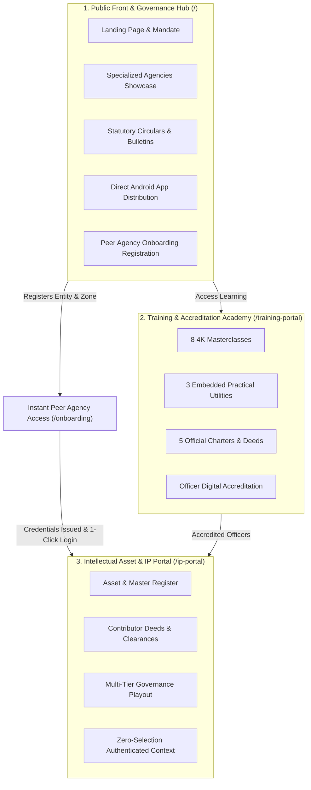
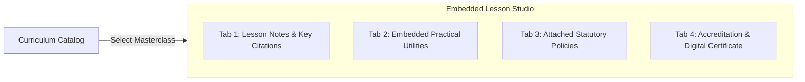
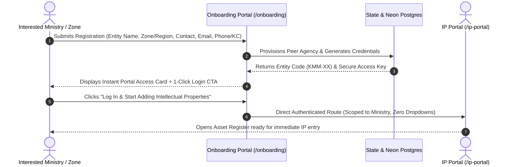
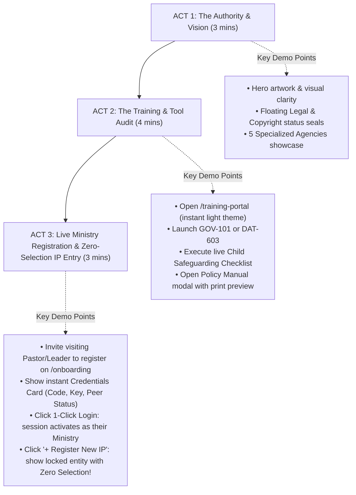

# Kiddies Media Ministry (KMM) Platform: Executive Walkthrough, Operational Guide & Expo Blueprint

> [!NOTE]
> This document provides an institutional overview of the Kiddies Media Ministry digital platform architecture, detailing the public presentation, the Training Academy with embedded compliance tools, the Intellectual Property (IP) Portal with peer agency equality, the zero-selection authentication system, the end-to-end ministry onboarding workflow with immediate access credentials, and the live Expo demonstration strategy.

---

> [!IMPORTANT]
> ### Secretariat Contact Requirement for All Enquiries
> To ensure rapid coordination and verified institutional communication across Loveworld Nation, the KMM Directorate requires all ministries, prospective producers, and exhibitors to maintain direct contact through any of the official enquiry channels:
> - **Direct Ministerial Phone Line**: `+234 803 000 0000` / `+234 812 345 6789`
> - **Official Secretariat Email**: `enquiry@kiddiesmediaministry.org` / `kmm.secretariat@loveworld.org`
> - **Kingschat (KC) Official Handle**: `@kmm` / `@kiddiesmediaministry` *(Kingschat Direct)*
>
> During registration and booth consultations, entities must provide an active phone number, email, and/or Kingschat handle for official credential issuance, legal title deed correspondence, and ongoing playout clearances.

---

## 1. Executive Summary & Core Platform Pillars

The Kiddies Media Ministry (KMM) platform is structured as a unified, tripartite ecosystem serving children's media producers, church zones, and international broadcast networks across Loveworld Kingdom:

---

## 2. Platform Architecture & Section Walkthrough

### Pillar 1: The Public Website & Institutional Role (`/`)
*Primary File: [`components/KmmLandingPage.tsx`](file:///c:/Users/dell/Desktop/Sylver/KMM/PROJECTS/Nextjs/kmm-portal/components/KmmLandingPage.tsx)*

1. **Hero & Authority Declaration**:
   - **Visual Canvas**: High-resolution, unwashed sky-blue natural artwork of children with the ministry's animated characters, creating an inviting yet authoritative atmosphere.
   - **Floating Legal Seal**: Real-time institutional status pills:
     - `Legal Clearance: Active` (Blue indicator)
     - `Copyright Status: Cleared` (Emerald indicator)
   - **Core Mandate**: Clearly declares KMM's role as the central governing authority establishing scriptural fidelity, technical broadcast standards, and child safety covenants across Loveworld Kingdom.
   - **Primary Calls to Action**:
     - *Start Officer Training* &rarr; Direct pathway into the Training Academy.
     - *Submit Expression of Interest* &rarr; Dedicated intake for zones and media units.

2. **Specialized Ministry Agencies Directory**:
   Presents the dedicated operational directorates that drive children's media:
   - **Lovetoons**: Flagship children animation, television broadcast, and creative entertainment.
   - **Publishing Agency**: Illustrated literature, comic books, devotional materials, and curriculum.
   - **Digital Agency**: Interactive mobile gaming, educational apps, AR/VR, and zero-tracking COPPA infrastructure.
   - **Academy Agency**: Regulatory compliance, officer certification, and safety covenant audits.
   - **Educational Agency**: School partnerships, early learning aids, and outreach kits.

3. **Resources, Institutional Circulars & Updates**:
   - Live bulletins, broadcast standards gazettes, and official guidance circulars.
   - Direct download modal for the official Android APK, allowing Expo attendees to install the Lovetoons mobile app directly onto their devices.

---

### Pillar 2: The Modernized Training & Accreditation Academy (`/training-portal`)
*Primary Files: [`app/training-portal/page.tsx`](file:///c:/Users/dell/Desktop/Sylver/KMM/PROJECTS/Nextjs/kmm-portal/app/training-portal/page.tsx), [`lib/data/trainingVideosData.ts`](file:///c:/Users/dell/Desktop/Sylver/KMM/PROJECTS/Nextjs/kmm-portal/lib/data/trainingVideosData.ts)*

The Training Portal operates in light theme by default, featuring a modern curriculum catalog and an integrated **Lesson Studio** where tools and policy documents live directly inside each masterclass.

#### Curriculum Masterclasses (8 Accredited Modules)
1. **`GOV-101`**: *Statutory Broadcast Content Standards & Pre-Release Clearances*
2. **`DAT-603`**: *COPPA & Digital Child Data Safeguards in Mobile Apps*
3. **`LAW-204`**: *Copyright Clearances: Original Music, Voiceovers & Character Likeness*
4. **`DEF-401`**: *Animation Defect Classification: Critical vs. Minor Quality Errors*
5. **`DOC-102`**: *Scriptural Fidelity & Biblical Accuracy in Kids Storytelling*
6. **`MER-502`**: *Global Merchandising, Toy Safety Standards & Territorial Covenants*
7. **`TAL-305`**: *Child Voice Actor Safeguards & Talent Welfare Guidelines*
8. **`INT-702`**: *International Subtitling, Dubbing & Multi-Language Harmonization*

#### Embedded Practical Compliance Utilities (Runnable inside lessons)
- **Tool 1: Child Safeguarding Audit Checklist**
  - Live 6-point statutory audit (Guardian release, strobe frequency $< 3\text{ Hz}$, loudness target $-24\text{ LKFS}$, non-frightening tone, work-for-hire score, and child privacy).
  - Dynamic score percentage indicator and one-click *Copy Verification Report*.
- **Tool 2: Content Age-Rating & Sensitivity Calculator**
  - Interactive selectors for Target Age ($0\text{–}3$, $4\text{–}7$, $8\text{–}12$, $13+$), Conflict Level, and Scriptural Depth.
  - Generates instant official advisory badges (`KMM-E`, `KMM-G`, `KMM-Y7`, `KMM-PG`) with broadcast window guidance.
- **Tool 3: IP Clearance & Licensing Verifier**
  - Audits 5 essential rights: Voice Actor Deeds, Master Sync Licenses, Character Silhouettes, Script IP, and Worldwide Territories.
  - Connects directly with the central IP Portal.

#### Accompanying Statutory Policy Documents (Directly attached to lessons)
- **`KMM-DOC-001`**: Official Child Safeguarding & Welfare Manual (18 Pages)
- **`KMM-DOC-002`**: Institutional Broadcast & Animation Standards Charter (24 Pages)
- **`KMM-DOC-003`**: Minor Contributor & Voice Talent Release Deed Template (8 Pages)
- **`KMM-DOC-004`**: Digital Minor Data Privacy & COPPA Compliance Directive (14 Pages)
- **`KMM-DOC-005`**: Scriptural Review & Doctrinal Integrity Protocol (16 Pages)
- *Features*: In-browser modal reader, instant text copy, and formatted PDF print export.

---

### Pillar 3: The Intellectual Property (IP) Portal (`/ip-portal`)
*Primary Files: [`app/ip-portal/page.tsx`](file:///c:/Users/dell/Desktop/Sylver/KMM/PROJECTS/Nextjs/kmm-portal/app/ip-portal/page.tsx), [`components/MainApp.tsx`](file:///c:/Users/dell/Desktop/Sylver/KMM/PROJECTS/Nextjs/kmm-portal/components/MainApp.tsx)*

#### 1. Peer Agency Equality Architecture
Registered church ministries and departments (e.g. *Children's Ministry - CE Lagos Zone 5*, *Healing School*, *Rhapsody Youth*, etc.) are elevated to the **exact same peer level as Lovetoons**:
- **Dedicated Scoped Registers**: Each ministry/department operates its own scoped asset catalog, contributor roster, and governance record.
- **Equal Administrative Rights**: Registered ministry admins have full authority to register assets, attach contributor releases, and submit for clearance.
- **Cross-Agency Visibility**: Global reviewers and Super Admins can filter across all 5 foundational agencies plus all registered ministries.

#### 2. The Zero-Selection Authentication Principle
To eliminate operational errors and streamline data entry, authentication automatically resolves who the user is:
- **No Dropdown Pickers**: Users **never have to select their agency or ministry from a dropdown at any point**.
- **New Asset Modal**: Originating Entity is automatically locked and displayed with a verified badge: `<Building2 /> {currentUser.agency} (Authenticated Entity)`.
- **Contributor Assignment**: Contributors added inside the New Asset modal or Edit Asset modal are locked to the authenticated entity.
- **Add Contributor Modal**: Agency selection is locked to `{asset.agency || currentUser.agency}`.
- **Approvals & Ledger**: Workflows automatically filter to the authenticated ministry.

---

## 3. The Ministry Onboarding & Instant Portal Access Workflow

### 1. Where an Entity Registers
- **Primary Route**: [`/onboarding`](file:///c:/Users/dell/Desktop/Sylver/KMM/PROJECTS/Nextjs/kmm-portal/app/onboarding/page.tsx)
- **Direct Entry Points**: Accessible from the main navigation header and landing page CTA buttons.

### 2. Information Collected
| Field Category | Specific Data Points | Purpose |
| :--- | :--- | :--- |
| **Entity Identity** | Ministry / Church Entity Name, Zone / Region / Jurisdiction | Establishes organizational peer identity |
| **Contact Officer** | Contact Person / Lead Officer Name | Designates administrative liaison |
| **Mandatory Communication** | Official Email, Phone Number, Kingschat Handle | Required for enquiry, verification, and credentials |
| **Discipline Focus** | Animation, Comics, Music, Games, TV Broadcast, Puppetry | Maps to the primary media focus area |
| **Asset Scope** | Concept stage, 1–5 assets, 6–20 assets, 20+ active assets | Measures catalog readiness |
| **Collaboration Goal** | IP Registration, Broadcast Syndication, Copyright Protection | Pre-configures initial portal permissions |
| **Overview Notes** | Brief current productions or accreditation requirements | Informs doctrinal and technical onboarding |

### 3. Immediate Access Credentials Issued Upon Registration
Upon form submission, the entity does not encounter a passive wait screen. Instead, the screen immediately renders the **Portal Access Credentials Card**:
- **Ministry / Entity Name**: e.g., `Children's Ministry - CE Lagos Zone 5`
- **Zone / Region**: e.g., `Lagos Zone 5 / Nigeria South`
- **Entity Identifier Code**: e.g., `KMM-LZ5CM`
- **Portal Login Email**: e.g., `pastor.grace@celz5.org`
- **Generated Secure Access Key (Password)**: e.g., `KMM-LZ5CM-9412`
- **Access Level**: `Full Agency Peer Status Granted • Equal to Lovetoons`

### 4. Direct 1-Click Portal Entry
- **Primary Action**: **"Log In & Start Adding Intellectual Properties &rarr;"**
  - Instantly activates the authenticated session for the registered ministry administrator.
  - Redirects immediately to `/ip-portal`.
  - When the user clicks **"Register New IP"**, the modal automatically recognizes their ministry without requiring them to select it from any dropdown.
- **Copy Credentials Action**: One-click action to copy all credentials, access keys, and portal URLs to clipboard for internal ministerial records.

---

## 4. Live Expo Demonstration Strategy

For the upcoming exhibition, the platform can be demonstrated through a 3-act narrative flow on a presentation screen or iPad station:

### Interactive Booth Stations
- **Station 1 (Presentation Display / Touch Monitor)**: Demonstrates the public landing page, agency highlights, and the interactive Masterclass video player.
- **Station 2 (Live Tablet Station)**: Dedicated to visitors registering their actual Zone or Ministry on `/onboarding`, receiving their live access key, and downloading the Android APK.
- **Station 3 (Directorate Command Screen)**: Displays the IP Portal and Waitlist Manager to demonstrate live administrative oversight to visiting executives.
- **Enquiry Banner & Cards**: Highlighting the required Secretariat enquiry channels:
  - Phone: `+234 803 000 0000`
  - Email: `enquiry@kiddiesmediaministry.org`
  - Kingschat: `@kmm` / `@kiddiesmediaministry`

---

## 5. Pre-Introduction Readiness Checklist

| Category | Component | Current Status | Action Required for Wide Rollout |
| :--- | :--- | :--- | :--- |
| **Public Web** | Hero, Agencies, Legal Seals | ✅ Complete | Ensure custom high-res hero assets are retained |
| **Public Web** | Android APK Playout | ✅ Operational | Verify latest `.apk` build file is placed in `/public` |
| **Training** | Default Light Theme | ✅ Fixed & Verified | None (persists across sessions via `kmm_training_theme`) |
| **Training** | Embedded Tools & Charters | ✅ Completed | Fully runnable inside video modules |
| **Peer Equality** | Ministry Peer Level | ✅ Completed | Ministries operate on identical level to Lovetoons |
| **Zero Selection** | Modal Entity Locking | ✅ Completed | All modals automatically lock to authenticated entity |
| **Onboarding** | Public Intake Form | ✅ Operational | Tested with live validation, access key generation, and 1-click login |
| **Onboarding** | PostgreSQL Storage | ✅ Operational | Configured with resilient state store and Neon database sync |
| **Enquiry Contact** | Contact Requirement | ✅ Completed | Phone, Email, and Kingschat channels documented |
| **Domain & SSL** | Webhook & DNS | 🟡 Pending Launch | Map apex and portal domains (`kiddiesmediaministry.org`) |

---

## 6. Recommended Immediate Next Steps
1. **Secretariat Enquiry Contacts Verification**: Ensure the official phone numbers and Kingschat handles (`@kmm`) are assigned to active secretariat duty officers before Expo opening day.
2. **Booth Demonstration Dry Run**: Conduct a 10-minute dry run of the 3-Act Expo Demonstration Flow to confirm team timing, especially demonstrating the instant access key generation and zero-selection modal lock in front of visiting ministers.
3. **Faculty & Speaker Alignment**: Verify final speaker titles in [`lib/data/trainingVideosData.ts`](file:///c:/Users/dell/Desktop/Sylver/KMM/PROJECTS/Nextjs/kmm-portal/lib/data/trainingVideosData.ts).
